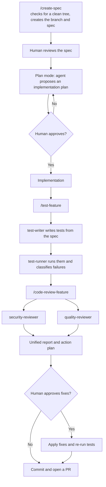
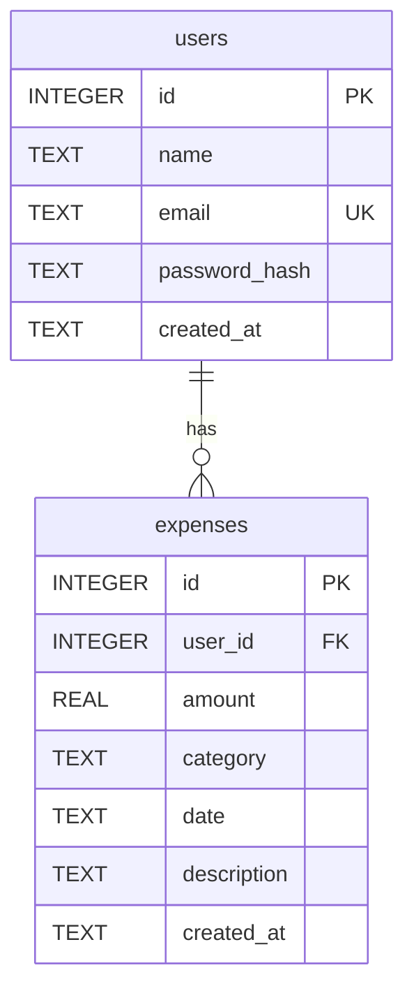

# Expensify

A personal expense tracker built with Flask and SQLite, developed spec-first with a team of Claude Code subagents.

Users can register, log in, record expenses and see their spending by date and category. This repo shows how I use AI coding agents to build and manage a real-world project. It covers everything from the rules and instructions they follow to the specs they work on, and how different agents handle coding, testing, and reviewing. There are also human checkpoints to make sure everything stays on track. All the configuration is available in the .claude/ folder, so you can explore exactly how the workflow is set up.

I built the project with [Claude Code](https://claude.com/claude-code), one feature at a time, and each part of the setup handles a different stage of the work:

- **Project context:** [`CLAUDE.md`](CLAUDE.md) gives every session the architecture, coding rules, commands and tech constraints. Agents don't have to guess the conventions, and they can't quietly add React or an ORM because that's what they usually reach for.
- **Specs:** each feature starts as a written spec in [`.claude/specs/`](.claude/specs). It lists the routes, database changes, files to touch, implementation rules and a definition of done that can be tested. The spec is the contract: code is planned from it, and tests are written from it.
- **Subagents:** four specialized agents in [`.claude/agents/`](.claude/agents) cover test writing, test running, security review and quality review. Each gets only the tools its job needs. The reviewers can't edit the code they review, and the test runner can't change a test to force a pass.
- **Custom slash commands:** five commands in [`.claude/commands/`](.claude/commands) turn repeated work into a process I can run again. `/create-spec` starts a feature, `/test-feature` runs the test pipeline, `/code-review-feature` runs both reviewers in parallel, and `/seed-user` and `/seed-expense` generate realistic test data.
- **MCP server:** a SQLite MCP server gives agents direct access to the database, so they can check the real schema and data without relying on what the code implies.
- **Custom skill:** the [`frontend-design`](.claude/skills/frontend-design/SKILL.md) skill tells agents to build new pages in the app's existing visual style, so they don't drift into a generic UI.

I stay in control of the decisions. I review each spec, approve the implementation plan before code is written, and approve review findings before they're fixed. Agent output gets checked too: during Step 07, a failing test turned out to be the test's own mistake, and one reviewer's complaint didn't hold up, so it was dropped.

## Contents

- [AI engineering highlights](#ai-engineering-highlights)
- [The agentic workflow](#the-agentic-workflow)
- [Case study: Step 07, Add Expense](#case-study-step-07-add-expense)
- [Case study: debugging an MCP timeout](#case-study-debugging-an-mcp-timeout)
- [Application features](#application-features)
- [Tech stack](#tech-stack)
- [Getting started](#getting-started)
- [Running the tests](#running-the-tests)
- [Project structure](#project-structure)
- [Routes](#routes)
- [Database schema](#database-schema)
- [Security](#security)
- [Roadmap](#roadmap)

## AI engineering highlights

| Skill | Where to see it in this repo |
| --- | --- |
| Context engineering | [`CLAUDE.md`](CLAUDE.md) gives every session the architecture, constraints, commands and off-limits actions |
| Spec-driven development | [`.claude/specs/`](.claude/specs) holds 7 specs, one per feature, each with a testable definition of done |
| Multi-agent orchestration | [`.claude/agents/`](.claude/agents) defines 4 subagents, and two slash commands run them as pipelines |
| Least-privilege agent design | Reviewers only get `Read`, `Grep`, `Glob` and `git diff`, so they can't edit the code they review |
| Prompt engineering | [`.claude/commands/`](.claude/commands) holds 5 reusable commands with ordered steps, stop conditions and handoff rules |
| Custom skills | [`.claude/skills/frontend-design/`](.claude/skills/frontend-design/SKILL.md) tells agents to match the existing design system instead of producing a generic UI |
| Tool integration (MCP) | A SQLite MCP server lets agents inspect the live schema and data |
| Evaluating AI output | Generated tests and review findings were checked before being acted on, as the case study below shows |
| Human-in-the-loop control | Plan approval and review approval are required before code changes |

## The agentic workflow

Every feature from Step 02 onward starts with a spec on its own branch. Code gets written only after a person approves a plan, and review findings get fixed only after a person approves those too.



### Subagents

Each subagent runs on Claude Sonnet with only the tools its job needs.

| Agent | Job | Tools | Design decision |
| --- | --- | --- | --- |
| `expensify-test-writer` | Writes pytest cases | `Read`, `Edit`, `Write`, `Grep`, `Glob` | Tests come from the spec, not the implementation, so they don't just repeat what the code already does. It can't run anything. |
| `expensify-test-runner` | Runs tests and diagnoses failures | `Read`, `Bash`, `Grep` | It has no edit tools, so it can't change a test or the app to force a pass. |
| `expensify-security-reviewer` | Reviews changed code for vulnerabilities | `Read`, `Grep`, `Glob`, `git diff` | Read-only, and limited to security. |
| `expensify-quality-reviewer` | Reviews Flask practices and maintainability | `Read`, `Grep`, `Glob`, `git diff` | Read-only, and limited to quality. Runs in parallel with the security review. |

### Slash commands

| Command | What it does |
| --- | --- |
| `/create-spec <step> <title>` | Stops if the working tree is dirty, updates `main`, creates a feature branch, researches the codebase and writes a spec in a fixed format |
| `/test-feature <spec>` | Runs test-writer and then test-runner, stopping if the first fails. It's forbidden from fixing code, so the report stays honest |
| `/code-review-feature <spec>` | Runs both reviewers in parallel, merges their findings into one prioritized plan, and waits for approval before touching a file |
| `/seed-user` | Creates one realistic dummy user |
| `/seed-expense <user_id> <count> <months>` | Generates realistic expenses for a user across a date range |

### Guardrails

- `CLAUDE.md` bans new frameworks, ORMs and unflagged packages, which stops agents from reaching for the usual React and SQLAlchemy defaults.
- Stub routes stay stubs until the active task targets that step, which limits scope creep.
- Tests point `DB_PATH` at a temporary file before importing the app, so agents can't damage the development database by running them.

## Case study: Step 07, Add Expense

This is what one full run of the pipeline produced.

**Spec and plan.** `/create-spec` produced [`07-add-expense.md`](.claude/specs/07-add-expense.md), with 24 definition-of-done items. The agent then wrote an implementation plan, which I approved before any code changed.

**Testing.** test-writer produced 78 test cases from the spec. 77 passed on the first run. The one failure was `test_app_py_contains_no_sql`, and test-runner traced it to a keyword check matching the error message `"Please select a valid category."`. That was a bad test, not an app bug. The agent replaced the keyword check with patterns for whole SQL statements, then confirmed they still caught real SQL.

**Review.** The two reviewers ran in parallel and found no Critical or High issues. Their findings included:

- Missing CSRF protection on POST forms, which the spec had deferred
- A hardcoded fallback `SECRET_KEY`
- `debug=True` hardcoded in the entry point
- A login check that Steps 8 and 9 would have copied again
- Three weak test assertions, one of which passed on almost any page containing a two-digit number

Not every finding held up. One reviewer complained about a one-line CSS rule in a file that already uses that style, so that one was dropped.

**Fixes.** After I approved the plan, the findings were fixed, 12 CSRF test cases were added, and the full suite finished at 154 passing.

## Case study: debugging an MCP timeout

The SQLite MCP server kept failing with `connection timed out after 30000ms`. The database and config were both fine. Timing the startup directly with a small MCP client showed the cause:

| Startup | Time to respond |
| --- | --- |
| `npx`, package not cached | 56.0s |
| `npx`, package cached | 2.4 to 3.5s |
| `node` directly, package installed | 1.2s |

The first-run install took longer than the 30-second limit, so the client was likely killing each attempt before the install could finish and be cached. With the cache populated, the server connected on the next retry.

An early test also failed because the probe itself was at fault: it wrote to the server's stdin through .NET, which may prepend a byte-order mark, and it got no reply from a healthy server. Rewriting the probe in Node gave reliable results.

## Application features

Working today:

- **Accounts:** registration, login and logout, with hashed passwords and server-side validation
- **Profile dashboard:** total spent, transaction count, top category, transaction history and a per-category breakdown
- **Date filtering:** custom ranges plus "This month" and "Last 3 months" presets, kept in the URL so views can be bookmarked
- **Adding expenses:** amount, category, date and an optional description, with validation
- **Landing page:** includes a video modal, plus terms and privacy pages

Amounts display in rupees (₹). The figures in the landing page's product preview, including its budget stat, are illustrative. Budgets aren't a feature yet.

## Tech stack

| Layer | Technology |
| --- | --- |
| Backend | Python 3.10+, Flask 3.1 |
| Database | SQLite through the standard `sqlite3` module, with no ORM |
| Frontend | Jinja2 templates, plain CSS, vanilla JavaScript |
| Testing | pytest, pytest-flask |
| AI tooling | Claude Code, custom subagents, slash commands, skills, MCP |

The stack is deliberately small, and the constraints are written into `CLAUDE.md` so agents keep to them.

## Getting started

```bash
git clone https://github.com/techy21/Expense-Tracker-Expensify.git
cd Expense-Tracker-Expensify

python -m venv .venv
source .venv/bin/activate        # Windows: .venv\Scripts\activate
pip install -r requirements.txt

python app.py
```

Open <http://localhost:5001>. The database is created on first run and seeded with a demo account:

- **Email:** `demo@expensify.com`
- **Password:** `demo123`

### Environment variables

Both are optional.

| Variable | Effect |
| --- | --- |
| `SECRET_KEY` | Keeps sessions valid across restarts. Without it, a random key is generated at startup and everyone is signed out on restart. |
| `FLASK_DEBUG=1` | Turns on debug mode and auto-reload. Use it for local development only. |

### Connecting the MCP server (optional)

With [Claude Code](https://claude.com/claude-code) installed, run this from the project root, using the full path to your database:

```bash
claude mcp add sqlite -s local -- npx -y @executeautomation/database-server /full/path/to/expense_tracker.db
```

On native Windows, use `cmd /c npx` in place of `npx`. The first run downloads the package and can exceed the default startup limit. If it times out, set `MCP_TIMEOUT=120000` before starting `claude`.

## Running the tests

```bash
pytest                                  # everything
pytest tests/test_07-add-expense.py     # one feature
pytest -k "csrf"                        # by name
```

The suite has 154 test cases covering Steps 06 and 07, and those steps' flows also exercise login. Tests run against temporary databases, so they never touch `expense_tracker.db`. Steps 01 to 05 predate the test pipeline and have no dedicated test files.

## Project structure

```text
.
├── .claude/
│   ├── agents/          # 4 subagent definitions
│   ├── commands/        # 5 slash commands
│   ├── skills/          # frontend-design skill
│   └── specs/           # one spec per feature
├── database/
│   └── db.py            # all SQL: connection, schema, seed data, queries
├── static/
│   ├── css/             # global styles plus one file per page
│   └── js/main.js
├── templates/           # Jinja2 templates extending base.html
├── tests/               # pytest suites
├── app.py               # all routes
├── CLAUDE.md            # project rules for AI agents
└── requirements.txt
```

## Routes

| Method | Path | Access | Status |
| --- | --- | --- | --- |
| GET | `/` | Public | Done |
| GET, POST | `/register` | Public | Done |
| GET, POST | `/login` | Public | Done |
| GET | `/logout` | Public | Done |
| GET | `/profile` | Logged in | Done, accepts `start_date` and `end_date` |
| GET, POST | `/expenses/add` | Logged in | Done |
| GET | `/expenses/<id>/edit` | | Stub, Step 8 |
| GET | `/expenses/<id>/delete` | | Stub, Step 9 |
| GET | `/terms`, `/privacy` | Public | Done |

## Database schema



Categories are a fixed list: Food, Transport, Bills, Health, Entertainment, Shopping and Other. SQLite leaves foreign keys off by default, so `get_db()` turns them on for every connection.

## Security

In place:

- Passwords hashed with Werkzeug, and login errors that don't reveal whether the email exists
- Parameterized SQL everywhere
- `user_id` always read from the session, never from request input
- CSRF tokens on every POST form, plus `SameSite=Lax` session cookies
- Allowlist validation for categories and strict checks on amounts and dates
- Jinja2 autoescaping, with tests confirming script tags render as text

Known gaps:

- `/logout` is a GET route, so another site could sign a user out. `/expenses/<id>/delete` must become POST when Step 9 is built.
- There's no rate limiting on login.
- This is a learning project and hasn't been hardened for production deployment.

## Roadmap

- [x] Steps 01 to 03: database setup, registration, login and logout
- [x] Steps 04 to 06: profile page, live data, date filtering
- [x] Step 07: add expense
- [ ] Step 08: edit expense
- [ ] Step 09: delete expense

## Author

Built by Bilal Tariq with [Claude Code](https://claude.com/claude-code). GitHub: [@techy21](https://github.com/techy21).
